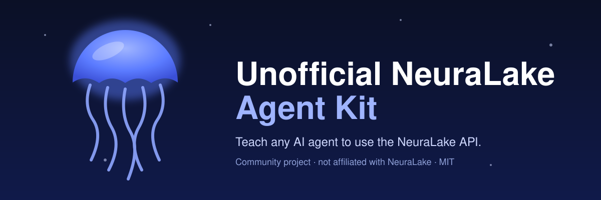

# 🪼 Unofficial NeuraLake Agent Kit

> **Aviso / Disclaimer:** projeto **não oficial**, mantido pela comunidade, sem vínculo, patrocínio ou endosso da NeuraLake. "NeuraLake" é nome/marca de seus respectivos donos, usado só para identificar o serviço. Informações podem estar desatualizadas (baseadas no beta, nov/2026): consulte a documentação oficial. This is an unofficial, community project, not affiliated with or endorsed by NeuraLake. Licença: MIT.

Repositório para ensinar **qualquer agente de IA** a usar a API de inferência NeuraLake (compatível com OpenAI).

## Como usar
- **Qualquer agente** (Codex, Cursor, Copilot, Aider…): aponte para `AGENTS.md` (ou `llms.txt`).
- **Claude Code:** copie `skills/neuralake/` para `~/.claude/skills/` (ou `.claude/skills/` do projeto).
- **Humanos:** comece por `docs/setup.md`.

## Conteúdo
| Caminho | Função |
|---|---|
| `AGENTS.md`, `llms.txt` | Ponto de entrada para agentes |
| `skills/neuralake/SKILL.md` | Skill instalável |
| `docs/` | Setup, capacidades, streaming, erros, conta e segurança, lacunas |
| `mcp-server/` | **Experimental e opcional**: MCP mínimo (chat e capacidades). Se a NeuraLake lançar MCP oficial, use o oficial e remova este. |
| `SECURITY.md`, `scripts/check_secrets.sh` | Regras anti-vazamento e verificação |
| `examples/` | Python, Node e cURL |
| `scripts/smoke_test.py` | Teste de conexão sem dependências |
| `evals/checklist.md` | Como verificar se o agente aprendeu |

## Status
Baseado na documentação do painel beta (2026-11-17). O que não foi verificado está em `docs/gaps.md`. Testado contra a API real em 2026-11-17 (smoke test, capacidades, streaming, JSON mode, tool calling, imagem, MCP).
